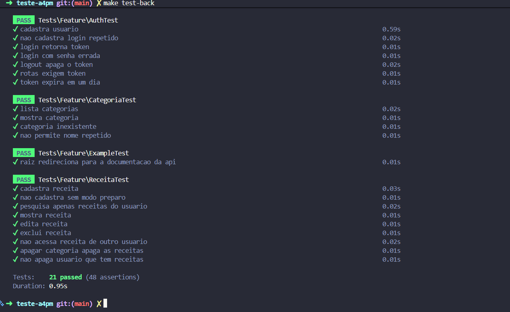
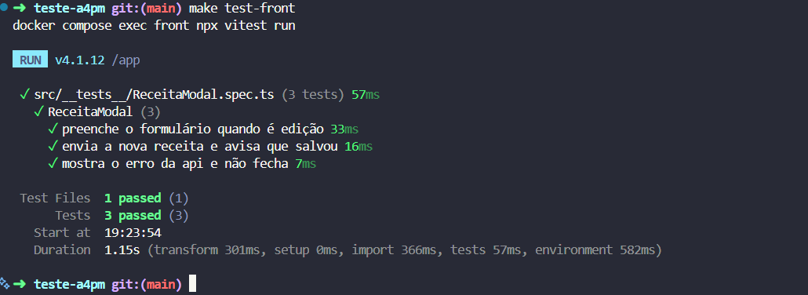
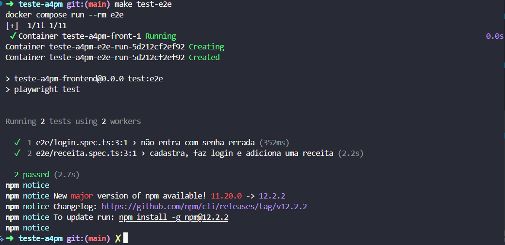
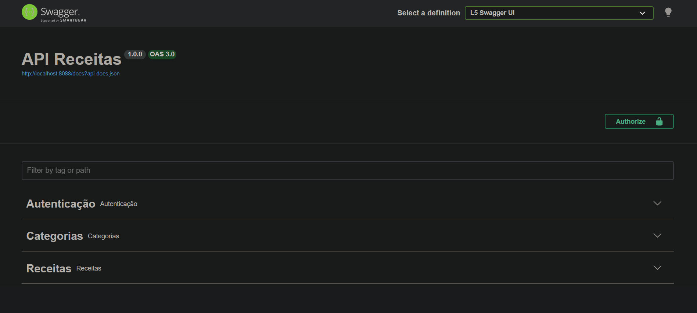

# teste-a4pm

Laravel 13 (PHP 8.4), Vue 3 com TypeScript e MySQL 8.4, tudo rodando no Docker.

## Desafio

Vaga de Desenvolvedor. O desafio é implementar o máximo das funcionalidades abaixo e entregar dentro do prazo combinado com a empresa.

### Funcionalidades

- Cadastro de usuário no sistema
- Login de usuário
- Logoff de usuário
- Cadastro de receitas pelo usuário
- Pesquisa de receitas cadastradas pelo usuário
- Edição de uma receita
- Exclusão de uma receita
- Impressão de uma receita

### Banco de dados

A modelagem foi enviada junto com o desafio e está em [docs/model.pdf](docs/model.pdf).

### Restrições

- API RESTful no backend com PHP e Laravel
- Frontend em Vue.js, se comunicando com o backend
- Banco de dados MySQL
- Guia explicando como rodar o sistema

Diferenciais: documentação da API (Swagger), Docker e testes unitários e de integração (E2E).

## Como rodar

Precisa de [Docker](https://docs.docker.com/get-started) e Make.

```bash
make up
```

O `make up` cria os `.env` a partir dos `.env.example` (se ainda não existirem), faz o build das imagens, roda `composer install`, `php artisan key:generate`, `php artisan migrate --seed`, `npm install` e sobe os containers com `docker compose up -d`.

| Serviço | Endereço |
|---|---|
| Frontend | http://localhost:5178 |
| API | http://localhost:8088/api |
| Swagger | http://localhost:8088/api/documentation |
| MySQL | `localhost:3308` |

### Usuário padrão

A seeder cria um usuário com 8 receitas já cadastradas:

- Login: `admin`
- Senha: `123456`

## Comandos

| Comando | O que faz |
|---|---|
| `make up` | Sobe o ambiente (instala dependências, roda migrations e seeders) |
| `make down` | Derruba o ambiente (os dados do MySQL ficam salvos) |
| `make test` | Roda os testes do back e do front |
| `make test-back` | Roda os testes do Laravel |
| `make test-front` | Roda os testes do Vue |
| `make test-e2e` | Roda os testes E2E com Playwright (precisa do ambiente no ar) |
| `make pint` | Formata o código do back com o Laravel Pint |
| `make docs` | Gera a documentação do Swagger |
| `make help` | Lista os comandos |

## Teste back



## Teste front


## Teste e2e


## API

Todas as rotas, menos cadastro e login, precisam do token no header `Authorization: Bearer <token>`. O token vale 1 dia.

| Método | Rota | O que faz |
|---|---|---|
| POST | `/api/usuarios` | Cadastra um usuário |
| POST | `/api/login` | Faz login e retorna o token |
| POST | `/api/logout` | Faz logoff e invalida o token |
| GET | `/api/receitas?nome=&id_categorias=` | Pesquisa as receitas do usuário |
| POST | `/api/receitas` | Cadastra uma receita |
| GET | `/api/receitas/{id}` | Mostra uma receita |
| PUT | `/api/receitas/{id}` | Edita uma receita |
| DELETE | `/api/receitas/{id}` | Exclui uma receita |
| GET | `/api/categorias` | Lista as categorias |
| GET | `/api/categorias/{id}` | Mostra uma categoria |

Cada usuário só vê e altera as próprias receitas. As categorias são fixas e vêm da seeder.

## Arquitetura

O back segue controller, service e repository. Os Form Requests validam a entrada, o controller só recebe e responde, a regra fica nos services (`app/Services`) e as consultas nos repositories (`app/Repositories`).

## Banco

- Desenvolvimento: `teste_a4pm`
- Testes: `a4pm_test`, criado automaticamente na primeira vez que os testes rodam.

As senhas do MySQL ficam no `.env` da raiz e a do Laravel em `backend/.env`.

## Documentação da API

Feita com [L5-Swagger](https://github.com/DarkaOnLine/L5-Swagger). Os endpoints são documentados com atributos `#[OA\...]` (`use OpenApi\Spec as OA;`) nos controllers e a documentação é gerada a cada acesso ao `/api/documentation`.


